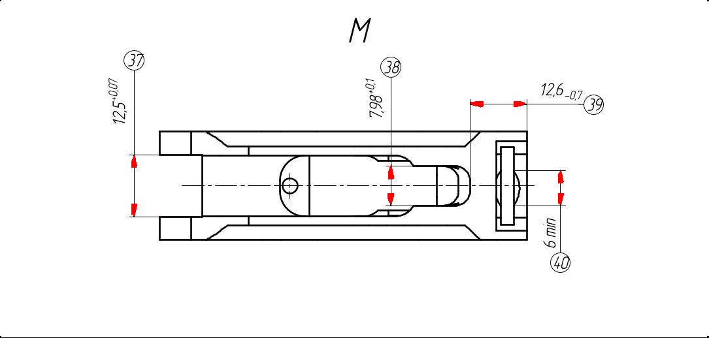

<div align="center">

# draftslice

**Чистка растровых чертежей: из скана — чистый лист без шума и виды детали для ViT.**


[Документация](docs/architecture/ARCHITECTURE.md) ·
[Установка](#установка) ·
[Использование](#использование) ·
[Модели](#модели) ·
[Обучение](#обучение)

</div>

**draftslice** — библиотека и CLI для обработки растровых чертежей. Находит на скане текст, стрелки, таблицы и
обозначения, удаляет всё, что не контур детали, и возвращает чистый лист в исходном масштабе. Контур при этом не
повреждается: пиксели оставленных линий берутся из самого листа. Дополнительно лист режется на **виды**, готовые для
подачи в ViT.

## 📄 Документация

| Раздел | О чём |
|---|---|
| [Архитектура](docs/architecture/ARCHITECTURE.md) | Карта пакетов, типы данных, последовательность вызовов |
| [`core.preprocess`](docs/architecture/modules/preprocess.md) | Серое, маска краски, нормализация масштаба |
| [`core.ocr`](docs/architecture/modules/ocr.md) | Текст на чертеже, в том числе повёрнутый |
| [`core.thick_lines`](docs/architecture/modules/thick_lines.md) | Граф линий, толстые и тонкие |
| [`core.denoise`](docs/architecture/modules/denoise.md) | Стрелки, правила чистки, чистый лист и виды |
| [Обучение модели стрелок](training/README.md) | Разметка, датасет, обучение, экспорт в ONNX, метрики |

## Установка

Python 3.11 или новее

```bash
pip install draftslice-0.1.0-py3-none-any.whl
```

На Linux ставятся `onnxruntime-gpu` и `paddlepaddle-gpu` (CUDA 13), на Windows и macOS — `paddlepaddle` для CPU.

## Использование

### CLI

```bash
# чистый лист в исходном масштабе; --plot — ещё картинка для проверки {имя}_plot.png
draftslice clean data/images -o runs/clean --plot

# виды листа {имя}_{k}.png, k — от крупного к мелкому; --size — квадрат для ViT
draftslice views data/images/1.jpg -o runs/views --size 224
```

| Аргумент | Команды | По умолчанию | Описание |
|---|---|---|---|
| `SOURCES` | `clean`, `views` | — | Листы или папки с листами (`.jpg`, `.png`, `.bmp`, `.tif`) |
| `--out`, `-o` | `clean`, `views` | `runs/clean`, `runs/views` | Папка результата |
| `--models` | `clean`, `views` | `models` | Папка с моделями: `arrows.onnx` и модели PaddleOCR |
| `--conf` | `clean`, `views` | `0.3` | Порог уверенности стрелок |
| `--plot` | `clean` | выкл. | Картинка проверки: чистое как в оригинале, снятое бледным, рамки видов |
| `--size` | `views` | — | Сторона квадрата для ViT; без неё вид сохраняется как есть |


### Python

```python
from draftslice.core.denoise.arrows import ArrowModel
from draftslice.core.denoise.pipeline import run
from draftslice.core.io import load_image
from draftslice.core.ocr.engine import OCREngine, PaddleOCRParameters

arrow_model = ArrowModel("models/arrows.onnx")  # модели создаются один раз на пачку листов
ocr_engine = OCREngine(PaddleOCRParameters())

res = run(load_image("sheet.png"), arrow_model, ocr_engine)
res.clean                                       # чистый лист RGB в исходном масштабе, фон белый
res.views                                       # виды для ViT
res.plot()                                      # картинка проверки
res.save("out/sheet.png")
res.save_views("out/views", "sheet", size=224)  # out/views/sheet_0.png, sheet_1.png, ...
```

Отдельные шаги (`preprocess`, `ocr`, `thick_lines`, правила `Sheet`) описаны в
[документации модулей](docs/architecture/modules/denoise.md#использование).

## Модели

Модели лежат в [`models/`](models/).

| Модель | Задача | Формат | Где используется |
|---|---|---|---|
| `arrows.onnx` — YOLO26n-seg | Сегментация стрелок | ONNX, NMS встроен в граф | `ArrowModel` |
| `PP-OCRv6_medium_det` | Детекция текста | PaddleOCR | `OCREngine` |
| `cyrillic_PP-OCRv5_mobile_rec` | Распознавание текста, кириллица | PaddleOCR | `OCREngine` |

Метрики модели стрелок (валидация на плитках 640, лучшая эпоха 119 из 300, запуск `tiles_yolo26n-seg_640-8`):

| Вывод | Precision | Recall | mAP50 | mAP50-95 |
|---|---|---|---|---|
| Бокс | 0.969 | 0.985 | 0.985 | 0.682 |
| Маска | 0.920 | 0.936 | 0.917 | 0.434 |

<sup>Валидация — 18 плиток, метрика маски на ней заметно колеблется от эпохи к эпохе (см.
[кривые обучения](training/README.md#метрики)).</sup>

<div align="center">

</div>

## Обучение

Модель стрелок обучается на плитках 640. Из подготовленного датасета:

```bash
python training/train.py --data data/dataset_yolo/tiles/data.yaml --imgsz 640 --epochs 300
```

Разметка в Label Studio, сборка датасета, экспорт в ONNX и проверка по листам — в
[training/README.md](training/README.md).

## 🧪 Тесты

```bash
pytest test/unit
```
