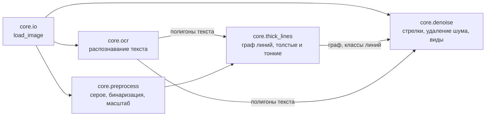

# Архитектура draftslice

Библиотека обработки растровых чертежей: от исходного скана до нарезки на регионы, готовые для
OCR и классификации толщины линий.

## Карта модулей

| Модуль | Роль | Вход | Выход |
|---|---|---|---|
| `core.io` | Загрузка изображения из пути, байтов или готовой матрицы | `str \| Path \| bytes \| np.ndarray` | `np.ndarray` RGB |
| `core.preprocess` | Серое, бинаризация и нормализация масштаба по толщине контура | `np.ndarray` (RGB) | `Preprocessed` |
| `core.ocr` | Распознавание текста на чертеже (в т.ч. повёрнутого) через PaddleOCR | `np.ndarray` (RGB) | `list[OcrResult]` |
| `core.thick_lines` | Граф линий по маске краски и деление линий на толстые (контур) и тонкие | маска краски `0/255` без текста, `dist`, `t_c` | `Skeleton`, `LineClasses` |
| `core.denoise` | Удаление шума: `ArrowModel` — стрелки моделью YOLO-seg (ONNX) по плиткам; `Sheet` — правила (стрелки, таблицы, обозначения) и чистая краска из оставленных путей скелета; `Views` — виды для ViT из исходного листа | `np.ndarray` (RGB, исходный масштаб); маска краски, граф, `dist`, классы, OCR | `ArrowResult`; `Sheet.clean` `0/255`; `Views` |

Подробности каждого модуля — в [`modules/`](modules/), история решений и открытые проблемы —
в [`decisions/`](decisions/).

## Общие примитивы core

Используются несколькими модулями, сами по себе не являются самодостаточным модулем пайплайна:

- `core/io.py` — `load_image`: лист RGB из пути, байтов или готового массива.
- `core/utils/checks.py` — проверки входа (`check_image`), как `ultralytics.utils.checks`: явный вызов в начале
  функции, ошибка — встроенное исключение (`TypeError`, `ValueError`).
- `core/utils/ops.py` — операции над изображением (`rotate_image`).

Своих alias типов и иерархии исключений нет: аннотации — `np.ndarray`, форма и dtype — в докстринге; ошибки —
встроенные исключения.
