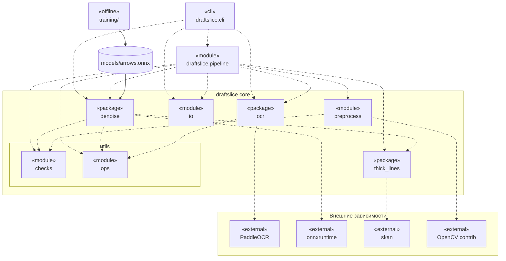
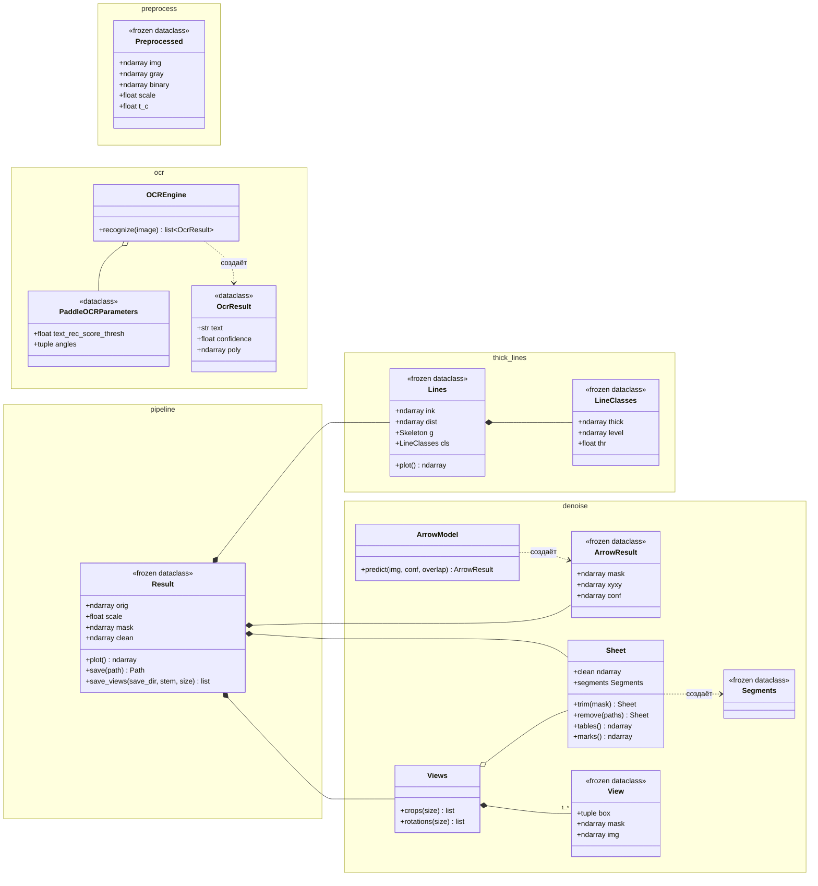
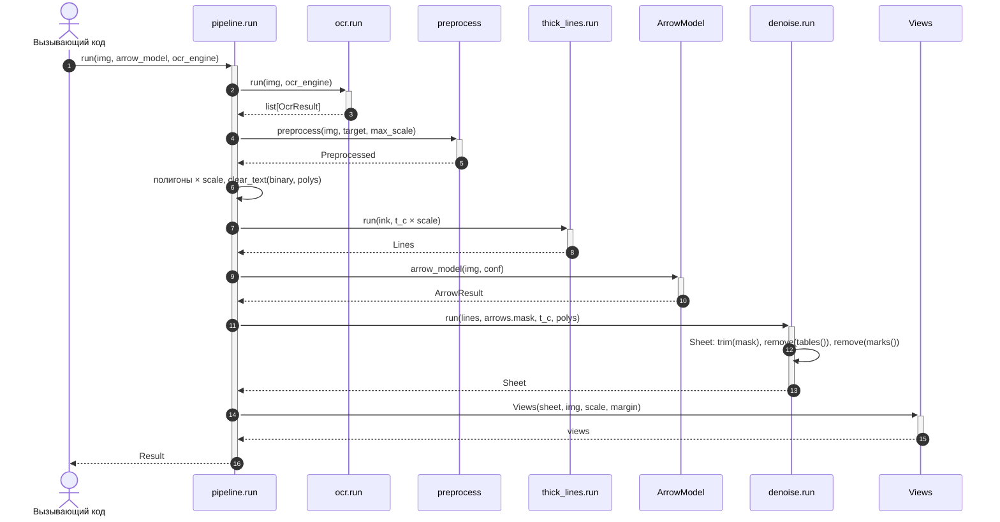

# Архитектура draftslice

Библиотека обработки растровых чертежей: из скана получает чистый лист без шума (стрелки, таблицы,
обозначения, текст) и виды детали для ViT. Работает как библиотека (`draftslice.pipeline.run` — весь лист,
`draftslice.core` — отдельные шаги) и как CLI (`draftslice clean`, `draftslice views`).

## Пакеты

Стрелка — зависимость по импорту: «использует». Данные между пакетами `core` передаёт пайплайн листа
`draftslice.pipeline`, см. [последовательность вызовов](#последовательность-вызовов).

| Пакет | Роль | Входит в публичный интерфейс |
|---|---|---|
| `pipeline` | Пайплайн листа: текст, масштаб, линии, стрелки, чистка, виды | `run`, `Result` |
| `core.io` | Загрузка и сохранение изображения | `load_image`, `save_image` |
| [`core.preprocess`](modules/preprocess.md) | Серое, маска краски, нормализация масштаба по толщине контура | `preprocess`, `Preprocessed` |
| [`core.ocr`](modules/ocr.md) | Текст на чертеже, в том числе повёрнутый: полигоны и строки | `run`, `OCREngine`, `OcrResult` |
| [`core.thick_lines`](modules/thick_lines.md) | Граф линий по маске краски, деление линий на толстые и тонкие | `run`, `Lines`, `build_graph`, `classify_lines` |
| [`core.denoise`](modules/denoise.md) | Стрелки, текст с маски краски, правила чистки, виды | `run`, `ArrowModel`, `clear_text`, `Sheet`, `Views` |
| `core.utils` | Проверки входа и операции над изображением | `check_image`, `rotate_image`, `scale_mask` |
| `cli` | Командная строка поверх `pipeline.run` | `draftslice clean`, `draftslice views` |
| `training/` | Разметка → датасет → обучение YOLO-seg → экспорт ONNX. Не импортируется пакетом | `models/arrows.onnx` |

## Типы данных и объекты

Публичные типы модулей и связи между ними. Функции без состояния не показаны (они в таблице выше и на страницах
модулей). `Skeleton` — класс skan.

## Последовательность вызовов

`pipeline.run` — единственное место, где пакеты соединяются. Из других пакетов `denoise` знает только тип
`thick_lines.Lines`.

Масштабы разные: текст и стрелки ищутся на исходном листе, линии и правила чистки — в
рабочем масштабе `preprocess`. Результат возвращается в исходный масштаб делением на `Preprocessed.scale`
(`utils.ops.scale_mask`).

## Общие примитивы

Не самодостаточные модули пайплайна, используются несколькими пакетами.

| Файл | Функции | Для чего |
|---|---|---|
| `core/io.py` | `load_image`, `save_image` | Лист RGB из пути, байтов или массива; запись с кириллицей в пути |
| `core/utils/checks.py` | `check_image` | Проверка входа: явный вызов в начале функции |
| `core/utils/ops.py` | `rotate_image`, `scale_mask` | Поворот листа с расширением холста; перенос маски между масштабами |

## Соглашения

- Аннотации — `np.ndarray`; форма и dtype указаны в докстринге. Своих alias типов нет.
- Ошибки — встроенные исключения: `TypeError`, `ValueError`, `FileNotFoundError`.
- Составной результат — `frozen dataclass`; правила чистки — методы объекта, общее считается один раз
  (`cached_property`).
- Изображение — RGB, `uint8`. Координаты пикселей — `(row, col)` в графе линий и `(x, y)` в боксах и полигонах.
- Модели (`ArrowModel`, `OCREngine`) создаются один раз и передаются в `pipeline.run`.

Подробности каждого пакета — в [`modules/`](modules/), проблемы и отброшенные варианты — в [`decisions/`](decisions/).
