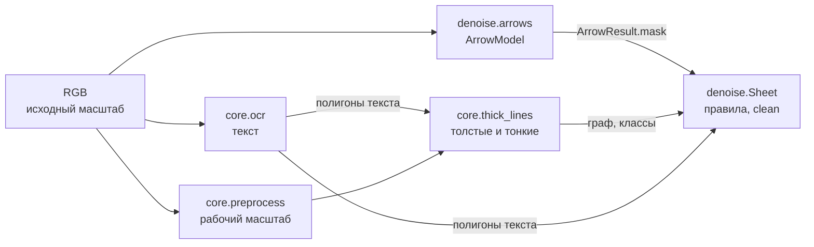
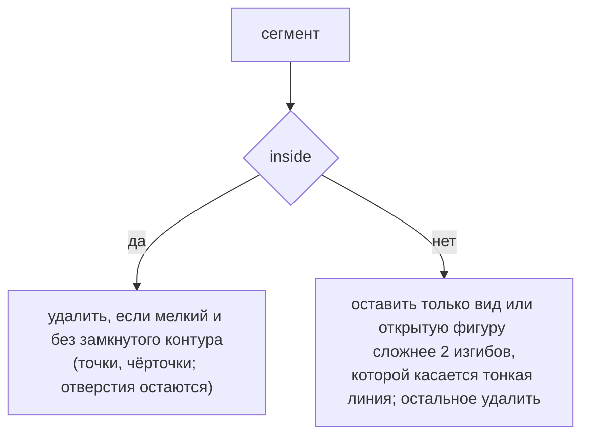

# Модуль: denoise

Удаление шума: всего, что не контур детали (DEL-03, DEL-05). Главное требование — не повредить контур
в местах пересечения или касания с удаляемой графикой (OQ-03).

В модуле три объекта, все в стиле Ultralytics — общее считается один раз и хранится в объекте:

- `ArrowModel` (`arrows.py`) — модель стрелок, вызывается на листах, возвращает `ArrowResult`;
- `Sheet` (`sheet.py`) — лист для чистки: правила — методы, чистая краска — кешируемое свойство `clean`;
- `Views` (`views.py`) — виды листа для ViT: группы сегментов, вырезанные из исходного листа.

```python
sheet = Sheet(ink, g, dist, cls.thick, t_c, polys)
sheet.trim(res.mask)
sheet.remove(sheet.tables())
sheet.remove(sheet.marks())
sheet.clean
```

Какие правила применять, пока решает блокнот; точка входа `pipeline.py` появится, когда порядок правил
устоится.

## Место в пайплайне



Порядок: текст, стрелки, классификатор линий. Классификатор получает маску краски без текста; стрелки в его
статистику пока не вычитаются (см. [решения](../decisions/denoise.md)).

Стрелки ищутся на **исходном** листе, а не в рабочем масштабе `preprocess`: модель учили на исходных листах.
`Sheet.trim` принимает маску в любом масштабе листа: пиксель пути $y$ берёт строку
$\lfloor y \cdot h_{mask} / h_{ink} \rfloor$ маски — целая часть, а не округление, иначе нижний ряд выходит за маску.

## Модель

| Файл | Что |
|---|---|
| `models/arrows.onnx` | YOLO26n-seg, экспорт `training/export.py` |
| `training/` | прогон: разметка → датасет → обучение → ONNX, см. `training/README.md` |

Интерфейс — как у Ultralytics: `ArrowModel` грузится один раз, вызывается на листах, возвращает `ArrowResult`
(`mask`, `xyxy`, `conf`, `len()`, `orig_shape`). Считает onnxruntime-gpu, без CUDA — на CPU.

Экспорт со встроенным NMS (`nms=True`) — та же голова и тот же NMS, что у `predict`/`val` Ultralytics на `.pt`,
поэтому ONNX совпадает с Ultralytics (`retina_masks=True`) по числу объектов, уверенности (до $5 \cdot 10^{-4}$)
и маскам. Порог уверенности встроенного NMS зашит в граф и ограничивает `conf` снизу, поэтому экспорт идёт с
`conf=0.001`, как у `val`.

!!! warning "Вход — RGB"
    Ultralytics переводит BGR в RGB перед сетью, значит, сеть обучена на RGB. Лист библиотеки уже RGB
    (`core.io`), поэтому каналы в `_blob` не переставляются.

## Плитки и зоны

Лист режется сеткой `tiles.grid` — той же, что при обучении (`training/make_dataset.py`, повторяет
`sahi.slicing.get_slice_bboxes`): плитка равна входу сети (640), перекрытие 0.2, последняя плитка в ряду
прижата к краю. Плитка меньше входа дополняется серым справа и снизу — координаты плитки не меняются.

Дубли между плитками убирает правило зон, а не NMS. Граница зон двух соседних плиток — середина их перекрытия:

$$
z = \frac{x_1^{(i)} + x_0^{(i+1)}}{2}
$$

Зоны делят лист без пересечений и пропусков. Находка засчитывается плитке, в зону которой попал центр её бокса:

- стрелка в перекрытии видна обеим плиткам, но её центр — в зоне одной;
- стрелку, обрезанную краем плитки, модель тоже находит (в обучении оставлены объекты с половиной площади), но
  центр такой находки лежит у края плитки, за границей зоны; целиком её видит соседняя плитка.

Условие правила: стрелка меньше половины перекрытия (64 px при плитке 640 и перекрытии 0.2).

## Маска

Маска объекта — как `ultralytics.utils.ops.process_mask_native`: коэффициенты × прототипы, билинейное
увеличение до входа, обрезка по боксу в полном разрешении, логит $> 0$. Вариант `process_mask` (обрезка в
масштабе прототипов, потом увеличение) даёт маску шире стрелки — для удаления нужна точная.

## Sheet: что считается один раз

| Свойство | Что | Пересчёт |
|---|---|---|
| `coords` | пиксели путей графа | один раз |
| `_start` | первый пиксель каждого пути — метка компоненты пути | один раз |
| `_ink_labels` | компоненты связности `ink` — группы правила `tables` | один раз |
| `text_h` | высота текста листа — медиана меньших сторон рамок OCR | один раз |
| `clean` | краска путей `keep` | после `remove` |
| `segments` | сегменты `clean` и их признаки (`Segments`) | после `remove` |

`keep` в начале — толстые пути; `remove(paths)` снимает пути, `trim(mask)` снимает стрелки и обрезает концы путей
(`span` — остающийся участок каждого пути); оба сбрасывают `clean` и `segments` и возвращают тот же лист.

Пороги правил — именованные параметры конструктора, как `overrides` у Ultralytics:
`Sheet(..., max_bends=2, small_h=1.0, circle_tol=1.0, min_cells=2)`. Порог уверенности стрелок `conf` — у
`ArrowModel`.

### `trim`

Наконечник стоит на конце линии, и классификатор не всегда отрезает его (клин толще линии меньше чем в
`thick_ratio` раз): ось с наконечником — один путь, и снятие пути «больше половины в маске» уносило линию вместе с
кромкой детали, по которой она идёт (лист 2, оси X, Y, Z). Маска модели чуть короче стрелки: остриё и основание
высовываются на несколько пикселей.

- Путь снимается целиком, если вне маски у него только короткие участки — короче $3 t_c$: наконечник.
- Иначе со **свободного** конца (остриё: степень пикселя 1) снимается участок в маске вместе с высунувшимся
  кончиком короче $3 t_c$.
- Конец в узле не обрезается: остриё чужой стрелки, упёртое в контур, контур не режет.

На листах 9, 14, 16 результат совпадает с правилом «больше половины в маске» пиксель в пиксель; на листе 2
возвращается кромка под осями; на листах 4, 5, 7, 11, 15 дополнительно уходят обрывки размерных линий между
двумя встречными наконечниками.

## Правила: какие пути удалить

Каждое правило — метод `Sheet` с выходом `(P,)` — маска путей на удаление; что удалять, решает вызывающий через
`remove`.

| Правило | Канон | Признак |
|---|---|---|
| `trim(mask)` | DEL-03, DEL-05 | стрелки по маске модели: наконечник целиком или обрезкой со свободного конца линии |
| `tables()` | DEL-07 | компонента краски с 2+ ячейками, большинство ячеек — прямоугольники с текстом |
| `marks()` | DEL-04, DEL-05 | сегмент `clean`: вне вида — всё, кроме видов и открытых фигур сложнее 2 изгибов; внутри вида — мелочь без контура |

### `tables`

Таблица на чертеже стоит отдельно — линии чертежа её не касаются, поэтому группа — компонента связности краски.
Ячейки — дыры в краске группы (`findContours`, `RETR_CCOMP`), ищутся по полному графу: внутренние линии таблицы
тонкие. Пороги — от толщины контура $t_c$, без подобранных чисел:

- ячейка прямоугольная — контур после `approxPolyDP` с точностью $t_c$ выпуклый четырёхугольник;
- дыра площадью меньше $t_c^2$ — щель в краске на стыке линий, не ячейка;
- ячейка с текстом — в неё попадает центр полигона OCR.

!!! warning "Не меньше двух ячеек"
    Одна дыра с текстом — это и прямоугольный вид с размером внутри контура: его удалять нельзя (OQ-04).
    Рамки вокруг одного текста и кружки позиций — DEL-04, отдельное правило.

### `marks`

Сегменты — компоненты связности текущего `clean` (свойство `segments`, поэтому `marks` вызывается после стрелок и
таблиц). Признаки сегмента, все от листа: $t_c$ — толщина контура, $h$ — высота текста.

| Признак | Определение |
|---|---|
| `holes` | замкнутые контуры — дыры площадью не меньше $t_c^2$ |
| `free` | дыры без текста — в дыру не попадает центр полигона OCR |
| `bends` | изгибы — прямые куски путей сегмента после `approxPolyDP` с точностью $t_c$, минус один |
| `small` | наибольшая сторона меньше $h$: отдельный вид не бывает меньше буквы |
| `circle` | точки скелета лежат на окружности: $\max \lvert d_i - \bar d \rvert \le t_c$ |
| `n_thin` | тонких путей, хоть один пиксель которых лежит в сегменте |
| `view` | есть дыра без текста, не мелкий, не круг и `n_thin > 0`: у вида всегда есть осевые, размеры или штриховка |
| `owner` | вид, в оболочке которого больше половины пикселей сегмента (оболочки — от меньшего вида к большему) |
| `inside` | `owner > 0` |



Вне вида: 2 изгиба — граница сложности обозначения (штрих — 0, полка выноски — 1, знак шероховатости — 2);
открытая скобка бокового вида пластины после снятия тонкой линии обрыва — 3, остаётся. Открытая фигура
сложнее 2 изгибов остаётся, только если её касается тонкая линия — то же требование, что у вида: профиль резьбы
выносного элемента (лист 20) касается штриховки и размеров, а буквы обозначения видов «Ж», «И», которых не нашёл
OCR (крупнее размерного текста, поэтому не `small`), — нет. Замкнутое, но не вид —
рамка вокруг текста (треугольник «п.1»), кружок позиции, крупная буква с петлями, которую не нашёл OCR («В»
обозначения разреза крупнее размерных чисел), — удаляется.

!!! warning "Риски"
    - Вид детали целиком круглый без других линий (шайба) окажется кругом вне видов. Отличие — осевые через центр.
    - Прямоугольный вид без отверстий, внутри контура которого стоит размер, окажется рамкой вокруг текста.
    - Вид, к которому не подходит ни одной тонкой линии (без осевых, размеров, штриховки), — не вид.

## clean: рисование вместо вычитания

Удаляемая графика делит пиксели с контуром там, где пересекает его или касается остриём. Вычитание её пикселей
порвало бы контур (OQ-03, OUT-03), поэтому краска путей `keep` рисуется заново:

$$
\text{clean} = \Big(\bigcup_{i \in keep} \text{polyline}_i\big(w_i\big)\Big) \cap \text{ink}, \qquad
w_i = \lceil 2 \cdot \operatorname{median}(dist_i) \rceil + 1
$$

- каждый оставленный участок пути (`span`) — ломаная `cv2.polylines` своей толщины $w_i$: медиана `dist` по пути,
  без раздувания у узлов, где к линии подходит удалённая;
- удалённые пути (тонкие, стрелки, таблицы, обозначения) не рисуются вовсе — на месте пересечения с контуром
  остаётся ломаная контура, пятна узлов и основания наконечников шире контура в маску не попадают;
- $\cap\,\text{ink}$ — ломаная не выходит за краску листа: торцы и края — пиксели самого листа.

Отдельная маска тонких не нужна: тонкие не рисуются, а пересечение с `ink` держит толстые в пределах краски.

!!! warning "Разрыв в самой краске не закрывается"
    Если контур прерван уже в `ink` (белый зазор вокруг острия стрелки в CAD-листе 20, растровый разрыв тонкой
    кривой под штриховкой на листе 12), `clean` разорван там же. Пиксели не склеиваются; разорванные куски одного
    вида собирает `Views` по близости (см. ниже).

## Views: виды для ViT

```python
views = Views(sheet, orig, scale=preprocessed.scale)  # после sheet.remove(sheet.marks())
views[0].box, views[0].mask, views[0].img            # View: рамка, маска и RGB в исходном масштабе
views.crops(size=224)                                # квадраты в общем масштабе листа (DUP-05)
views.rotations(size=224)                            # 0/90/180/270 (DUP-06)
```

| Шаг | Правило |
|---|---|
| группа | сегмент-вид и все сегменты с `owner` = этот вид; сегменты ближе двух максимальных толщин листа $2 \cdot 2\max(dist)$ — один вид (контур, разорванный в `ink`); сегмент без вида-хозяина и без соседей (открытая скобка) — отдельный вид |
| рамка | габарит группы с отступом `margin` толщин контура (VIEW-01; по OQ-05 подбирается, по умолчанию 3 — как в ветке `dev`), в координатах исходного листа |
| маска | пиксель $(Y, X)$ исходного листа берёт пиксель рабочей маски $(\lfloor Y s \rfloor, \lfloor X s \rfloor)$, $s$ — `Preprocessed.scale` |
| картинка | пиксели исходного листа под маской, фон белый (OQ-02) |
| порядок | от крупной рамки к мелкой, при равной — сверху вниз, слева направо |
| квадраты | общий множитель листа: самый крупный вид — во весь квадрат, остальные тем же множителем (как в `dev`: мелкий вид не раздувается до размера крупного), по центру белого квадрата |

