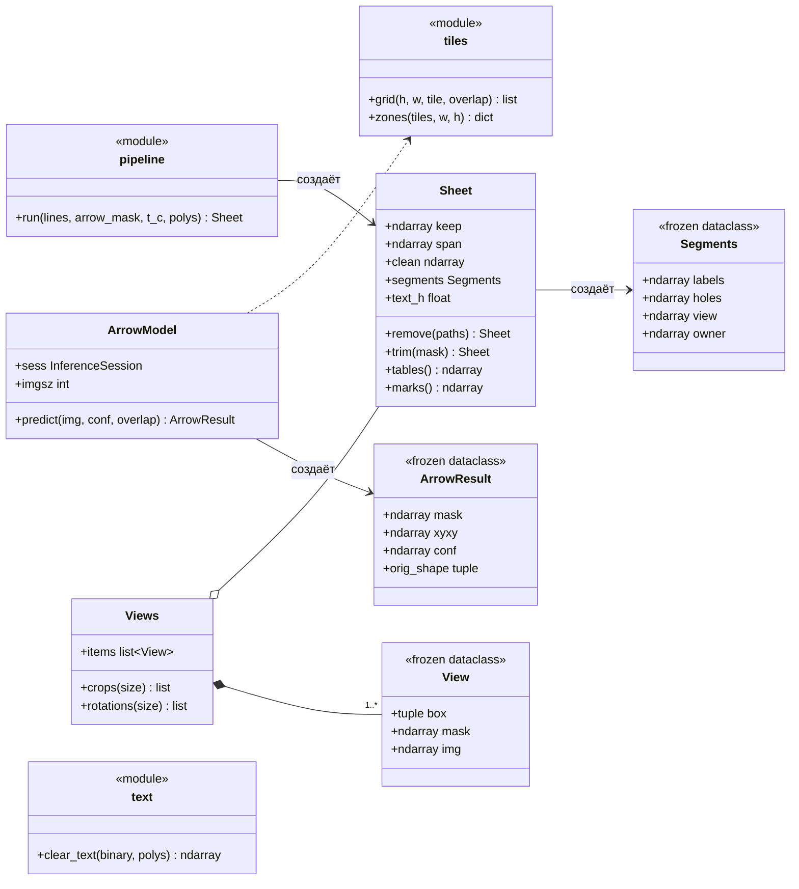
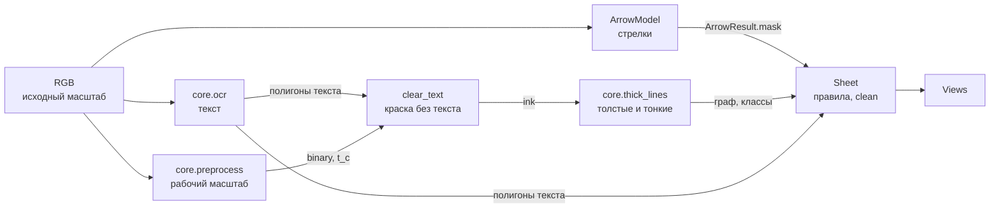
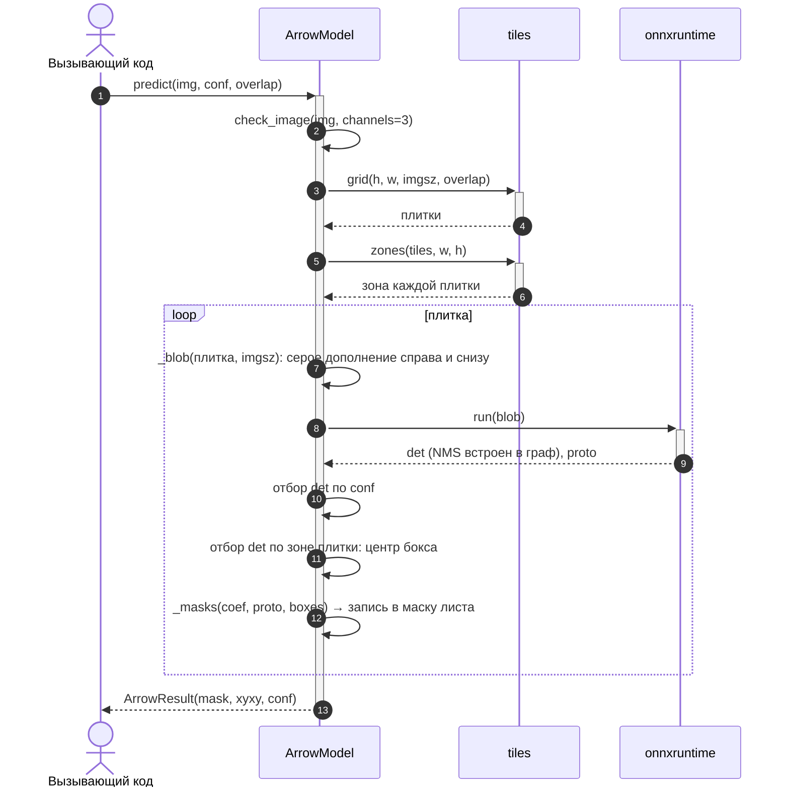
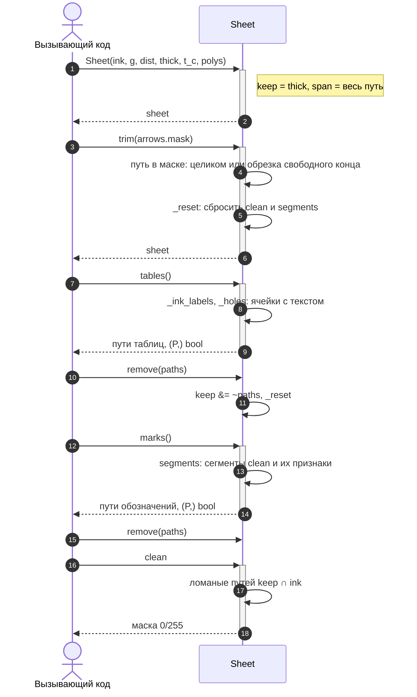
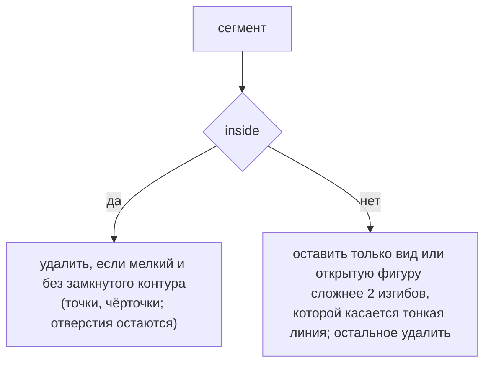
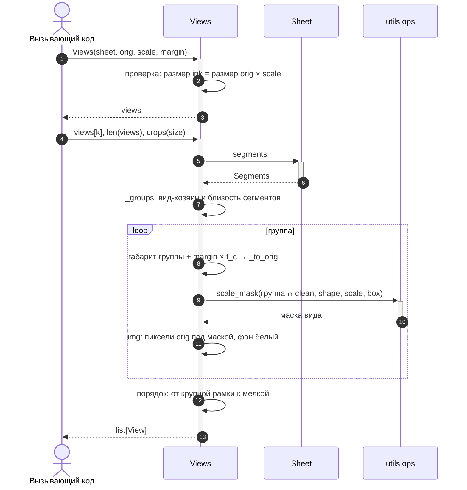

# core.denoise

Удаление шума: всего, что не контур детали — стрелок, таблиц, обозначений и текста, и нарезка чистой краски на
виды детали для ViT. Главное требование: не повредить контур в местах, где он пересекается или касается удаляемой
графики.

Весь лист — от исходного изображения до видов — обрабатывает `draftslice.pipeline.run`
(см. [последовательность вызовов](../ARCHITECTURE.md#последовательность-вызовов)).

## Использование

```python
from draftslice.core.denoise.pipeline import run

# lines — thick_lines.Lines, arrows — ArrowResult, polys — полигоны OCR в масштабе lines.ink
sheet = run(lines, arrows.mask, t_c, polys)
sheet.clean                      # чистая краска 0/255 в рабочем масштабе
```

Правила чистки по одному:

```python
# lines — thick_lines.Lines, arrows — ArrowResult, polys — полигоны OCR в масштабе lines.ink
sheet = Sheet(lines.ink, lines.g, lines.dist, lines.cls.thick, t_c, polys)
sheet.trim(arrows.mask)          # стрелки по маске модели
sheet.remove(sheet.tables())     # таблицы
sheet.remove(sheet.marks())      # обозначения
sheet.clean                      # чистая краска из оставленных путей
```

## Интерфейс



| Объект | Файл | Описание |
|---|---|---|
| `run(lines, arrow_mask, t_c, polys)` | `pipeline.py` | Правила чистки: стрелки, таблицы, обозначения |
| `ArrowModel` | `arrows.py` | YOLO-seg в ONNX: стрелки по плиткам листа |
| `ArrowResult` | `arrows.py` | Маска стрелок листа, боксы, уверенность |
| `grid`, `zones` | `tiles.py` | Сетка плиток и зоны плиток для склейки находок без дублей |
| `clear_text(binary, polys)` | `text.py` | Снимает с маски краски компоненты текста по полигонам OCR |
| `Sheet` | `sheet.py` | Краска, граф, пути, которые остаются; правила `trim`, `tables`, `marks`; `clean` |
| `Segments` | `sheet.py` | Сегменты `clean` и их признаки |
| `Views`, `View` | `views.py` | Виды листа: рамка, маска и картинка в исходном масштабе; квадраты и повороты |

## Аргументы

`run`:

| Аргумент | Тип | По умолчанию | Описание |
|---|---|---|---|
| `lines` | `Lines` | — | Краска без текста, граф и классы линий в рабочем масштабе (`thick_lines.run`) |
| `arrow_mask` | `np.ndarray[uint8]` | — | Маска стрелок `0/255` `(h, w)` в любом масштабе листа (`ArrowResult.mask`) |
| `t_c` | `float` | — | Толщина контура в рабочем масштабе, px |
| `polys` | `list[np.ndarray]` | — | Полигоны OCR `(4, 2)`, точки `(x, y)` в рабочем масштабе |

`ArrowModel` и `ArrowModel.predict`:

| Аргумент | Тип | По умолчанию | Описание |
|---|---|---|---|
| `model` | `str \| Path` | — | ONNX из `training/export.py` |
| `device` | `str` | `"cuda"` | `cuda` — GPU, если onnxruntime видит CUDA, иначе CPU; `cpu` — всегда CPU |
| `conf` | `float` | `0.25` | Порог уверенности, в [0, 1] |
| `overlap` | `float` | `0.2` | Перекрытие плиток, доля стороны, в [0, 1); как при обучении |

Пороги правил `Sheet` — именованные аргументы конструктора:

| Аргумент | Тип | По умолчанию | Описание |
|---|---|---|---|
| `max_bends` | `int` | `2` | Открытая фигура вне вида с изгибами не больше `max_bends` — обозначение (`marks`) |
| `small_h` | `float` | `1.0` | Сегмент мелкий, если его наибольшая сторона меньше `small_h` высот текста |
| `circle_tol` | `float` | `1.0` | Сегмент — круг, если точки скелета отходят от окружности не дальше `circle_tol` толщин контура |
| `min_cells` | `int` | `2` | Наименьшее число ячеек таблицы (`tables`) |

## Место в пайплайне

Шаги `denoise` в `draftslice.pipeline.run`: `clear_text` — до `thick_lines`, `ArrowModel`, `denoise.run` (`Sheet`) и
`Views` — после.



Порядок: текст, стрелки, классификатор линий. Классификатор получает маску краски без текста; стрелки в его
статистику пока не вычитаются.

Стрелки ищутся на **исходном** листе, а не в рабочем масштабе `preprocess`: модель учили на исходных листах.
`Sheet.trim` принимает маску в любом масштабе листа: пиксель пути $y$ берёт строку
$\lfloor y \cdot h_{mask} / h_{ink} \rfloor$ маски — целая часть, а не округление, иначе нижний ряд выходит за маску.

## Модель стрелок

| Файл | Что |
|---|---|
| `models/arrows.onnx` | YOLO26n-seg, экспорт `training/export.py` |
| `training/` | Разметка → датасет → обучение → ONNX, см. `training/README.md` |

!!! warning "Модель обучена на плитках"
    Скрипты `training/` умеют обучать и на целых листах (`make_dataset.py --no-tile`, `train.py --imgsz 1280`), но
    рабочая модель обучена на плитках 640, и `ArrowModel` режет лист той же сеткой (см. [плитки и зоны](#плитки-и-зоны)).
    Модель, обученная на целых листах, `ArrowModel` не рассчитана: вход сети — одна плитка.

`ArrowModel` грузится один раз, вызывается на листах, возвращает `ArrowResult` (`mask`, `xyxy`, `conf`, `len()`,
`orig_shape`). Считает onnxruntime-gpu, без CUDA — на CPU.

Экспорт со встроенным NMS (`nms=True`) — та же голова и тот же NMS, что у `predict`/`val` Ultralytics на `.pt`,
поэтому ONNX совпадает с Ultralytics (`retina_masks=True`) по числу объектов, уверенности (до $5 \cdot 10^{-4}$) и
маскам. Порог уверенности встроенного NMS зашит в граф и ограничивает `conf` снизу, поэтому экспорт идёт с
`conf=0.001`.

!!! warning "Вход — RGB"
    Ultralytics переводит BGR в RGB перед сетью, значит, сеть обучена на RGB. Лист библиотеки уже RGB
    (`core.io`), поэтому каналы в `_blob` не переставляются.

### Инференс



### Плитки и зоны

Лист режется сеткой `tiles.grid` — той же, что при обучении (`training/make_dataset.grid`): плитка равна входу сети (640), перекрытие 0.2, последняя плитка в ряду прижата к
краю. Плитка меньше входа дополняется серым справа и снизу — координаты плитки не меняются.

Дубли между плитками убирает правило зон, а не NMS. Граница зон двух соседних плиток — середина их перекрытия:

$$
z = \frac{x_1^{(i)} + x_0^{(i+1)}}{2}
$$

Зоны делят лист без пересечений и пропусков. Находка засчитывается плитке, в зону которой попал центр её бокса.

Пример: ширина листа 1200 px, плитка 640, перекрытие 0.2 (шаг 512). Одна ось, 1 символ ≈ 20 px:

```text
x, px     0                            576           856           1200
плитка 0  ├───────────────────────────────┤                 [0, 640)
плитка 1                            ├───────────────────────────────┤  [512, 1152)
плитка 2                              ├───────────────────────────────┤  [560, 1200)
зона 0    ├────────────────────────────┤                     [0, 576)
зона 1                                 ├─────────────┤       [576, 856)
зона 2                                               ├────────────────┤  [856, 1200)
```

- стрелка в перекрытии видна обеим плиткам, но её центр — в зоне одной;
- стрелку, обрезанную краем плитки, модель тоже находит (в обучении оставлены объекты с половиной площади), но
  центр такой находки лежит у края плитки, за границей зоны; целиком её видит соседняя плитка.

Условие правила: стрелка меньше половины перекрытия (64 px при плитке 640 и перекрытии 0.2).

### Маска

Маска объекта: коэффициенты × прототипы, билинейное увеличение до входа, обрезка по боксу в полном разрешении,
логит $> 0$. Обрезка в масштабе прототипов до увеличения даёт маску шире стрелки — для удаления нужна точная.

## clear_text: текст с маски краски

Компонента связности краски — текст, если:

- больше половины её площади лежит в полигонах OCR, **или**
- она целиком лежит в рамке одного полигона, расширенной на полвысоты строки с каждой стороны (хвосты букв,
  индексы, точки за краем полигона).

Линия чертежа, которую полигон задел, остаётся: у неё в полигоне малая доля площади, и в рамку она целиком не входит.

## Sheet: что считается один раз

| Свойство | Что | Пересчёт |
|---|---|---|
| `coords` | Пиксели путей графа | Один раз |
| `_start` | Первый пиксель каждого пути — метка компоненты пути | Один раз |
| `_ink_labels` | Компоненты связности `ink` — группы правила `tables` | Один раз |
| `text_h` | Высота текста листа — медиана меньших сторон рамок OCR | Один раз |
| `clean` | Краска путей `keep` | После `remove` и `trim` |
| `segments` | Сегменты `clean` и их признаки (`Segments`) | После `remove` и `trim` |

`keep` в начале — толстые пути. `remove(paths)` снимает пути, `trim(mask)` снимает стрелки и обрезает концы путей
(`span` — остающийся участок каждого пути). Оба сбрасывают `clean` и `segments` и возвращают тот же лист.

### Жизненный цикл



### trim

Наконечник стоит на конце линии, и классификатор не всегда отрезает его (клин толще линии меньше чем в
`thick_ratio` раз): ось с наконечником — один путь, и снятие пути «больше половины в маске» уносило линию вместе с
кромкой детали, по которой она идёт. Маска модели чуть короче стрелки: остриё и основание высовываются на несколько
пикселей.

- Путь снимается целиком, если вне маски у него только короткие участки — короче $3 t_c$: наконечник.
- Иначе со **свободного** конца (остриё: степень пикселя 1) снимается участок в маске вместе с высунувшимся
  кончиком короче $3 t_c$.
- Конец в узле не обрезается: остриё чужой стрелки, упёртое в контур, контур не режет.

```text
ось с наконечником — один путь графа

путь           ━━━━━━━━━━━━━━━━━━━━━━━━━━━━━━━━◀▮     ◀▮ — наконечник
маска модели                               ▒▒▒▒▒▒▒     чуть короче стрелки
после trim     ━━━━━━━━━━━━━━━━━━━━━━━━━━━━━━━          свободный конец обрезан, линия осталась

наконечник в узле (остриё упёрто в контур)
               ═══════╪═══════
                      ▲          конец в узле не обрезается: контур цел
```

## Правила: какие пути удалить

Каждое правило — метод `Sheet` с выходом `(P,)`: маска путей. Что удалять, решает вызывающий через `remove`.

| Правило | Признак |
|---|---|
| `trim(mask)` | Стрелки по маске модели: наконечник целиком или обрезкой со свободного конца линии |
| `tables()` | Компонента краски с 2+ ячейками, большинство ячеек — прямоугольники с текстом |
| `marks()` | Сегмент `clean`: вне вида — всё, кроме видов и открытых фигур сложнее 2 изгибов; внутри вида — мелочь без контура |

### tables

Таблица на чертеже стоит отдельно — линии чертежа её не касаются, поэтому группа — компонента связности краски.
Ячейки — дыры в краске группы (`findContours`, `RETR_CCOMP`), ищутся по полному графу: внутренние линии таблицы
тонкие. Пороги — от толщины контура $t_c$:

- ячейка прямоугольная — контур после `approxPolyDP` с точностью $t_c$ выпуклый четырёхугольник;
- дыра площадью меньше $t_c^2$ — щель в краске на стыке линий, не ячейка;
- ячейка с текстом — в неё попадает центр полигона OCR.

!!! warning "Не меньше двух ячеек"
    Одна дыра с текстом — это и прямоугольный вид с размером внутри контура: его удалять нельзя. Рамки вокруг одного
    текста и кружки позиций снимает `marks`.

### marks

Сегменты — компоненты связности текущего `clean` (свойство `segments`, поэтому `marks` вызывается после стрелок и
таблиц). Признаки сегмента, все от листа: $t_c$ — толщина контура, $h$ — высота текста.

| Признак | Определение |
|---|---|
| `holes` | Замкнутые контуры — дыры площадью не меньше $t_c^2$ |
| `free` | Дыры без текста — в дыру не попадает центр полигона OCR |
| `bends` | Изгибы — прямые куски путей сегмента после `approxPolyDP` с точностью $t_c$, минус один |
| `small` | Наибольшая сторона меньше $h$: отдельный вид не бывает меньше буквы |
| `circle` | Точки скелета лежат на окружности: $\max \lvert d_i - \bar d \rvert \le t_c$ |
| `n_thin` | Тонких путей, хоть один пиксель которых лежит в сегменте |
| `view` | Есть дыра без текста, не мелкий, не круг и `n_thin > 0`: у вида всегда есть осевые, размеры или штриховка |
| `owner` | Вид, в оболочке которого больше половины пикселей сегмента (оболочки — от меньшего вида к большему) |
| `inside` | `owner > 0` |



Сегменты вне вида, по числу изгибов и замкнутости:

| Сегмент | Изгибов | Судьба |
|---|---|---|
| Штрих | 0 | Удаляется |
| Полка выноски | 1 | Удаляется |
| Знак шероховатости | 2 | Удаляется |
| Скобка бокового вида, профиль резьбы | 3 и больше, открытая | Остаётся, если её касается тонкая линия |
| Буквы обозначения видов «Ж», «И», которых не нашёл OCR | 3 и больше, открытая | Удаляются: тонкая линия не касается |
| Кружок позиции, рамка вокруг текста, буква с петлями | Замкнутое, но не вид | Удаляются |

Вне вида: 2 изгиба — граница сложности обозначения (штрих — 0, полка выноски — 1, знак шероховатости — 2); открытая
скобка бокового вида пластины после снятия тонкой линии обрыва — 3, остаётся. Открытая фигура сложнее 2 изгибов
остаётся, только если её касается тонкая линия — то же требование, что у вида: профиль резьбы выносного элемента
касается штриховки и размеров, а буквы обозначения видов «Ж», «И», которых не нашёл OCR (крупнее размерного текста,
поэтому не `small`), — нет. Замкнутое, но не вид — рамка вокруг текста (треугольник «п.1»), кружок позиции, крупная
буква с петлями, которую не нашёл OCR («В» обозначения разреза крупнее размерных чисел), — удаляется.

!!! warning "Риски"
    - Вид детали целиком круглый без других линий (шайба) окажется кругом вне видов. Отличие — осевые через центр.
    - Прямоугольный вид без отверстий, внутри контура которого стоит размер, окажется рамкой вокруг текста.
    - Вид, к которому не подходит ни одной тонкой линии (без осевых, размеров, штриховки), — не вид.

## clean: рисование вместо вычитания

Удаляемая графика делит пиксели с контуром там, где пересекает его или касается остриём. Вычитание её пикселей
порвало бы контур, поэтому краска путей `keep` рисуется заново:

$$
\text{clean} = \Big(\bigcup_{i \in keep} \text{polyline}_i\big(w_i\big)\Big) \cap \text{ink}, \qquad
w_i = \lceil 2 \cdot \operatorname{median}(dist_i) \rceil + 1
$$

- каждый оставленный участок пути (`span`) — ломаная `cv2.polylines` своей толщины $w_i$: медиана `dist` по пути,
  без раздувания у узлов, где к линии подходит удалённая;
- удалённые пути (тонкие, стрелки, таблицы, обозначения) не рисуются вовсе — на месте пересечения с контуром
  остаётся ломаная контура, пятна узлов и основания наконечников шире контура в маску не попадают;
- $\cap\,\text{ink}$ — ломаная не выходит за краску листа: торцы и края — пиксели самого листа.

```text
вычитание пикселей стрелки              рисование путей keep

 ════════╗ ╔════════                     ═════════════════
         ║ ║   ← разрыв контура                           контур цел: путь стрелки не рисуется,
 ════════╝ ╚════════                     ═════════════════ его пиксели в маску не попадают
```

Отдельная маска тонких не нужна: тонкие не рисуются, а пересечение с `ink` держит толстые в пределах краски.

!!! warning "Разрыв в самой краске не закрывается"
    Если контур прерван уже в `ink` (белый зазор вокруг острия стрелки в CAD-листе, растровый разрыв тонкой кривой
    под штриховкой), `clean` разорван там же. Пиксели не склеиваются; разорванные куски одного вида собирает `Views`
    по близости (см. ниже).

## Views: виды для ViT

```python
views = Views(sheet, orig, scale=prep.scale)  # после sheet.remove(sheet.marks())
views[0].box, views[0].mask, views[0].img     # View: рамка, маска и RGB в исходном масштабе
views.crops(size=224)                         # квадраты в общем масштабе листа
views.rotations(size=224)                     # по виду: повороты 0/90/180/270
```



| Шаг | Правило |
|---|---|
| Группа | Сегмент-вид и все сегменты с `owner` = этот вид; сегменты ближе двух максимальных толщин листа $2 \cdot 2\max(dist)$ — один вид (контур, разорванный в `ink`); сегмент без вида-хозяина и без соседей (открытая скобка) — отдельный вид |
| Рамка | Габарит группы с отступом `margin` толщин контура, в координатах исходного листа |
| Маска | Пиксель $(Y, X)$ исходного листа берёт пиксель рабочей маски $(\lfloor Y s \rfloor, \lfloor X s \rfloor)$, $s$ — `Preprocessed.scale` |
| Картинка | Пиксели исходного листа под маской, фон белый |
| Порядок | От крупной рамки к мелкой, при равной — сверху вниз, слева направо |
| Квадраты | Общий множитель листа: самый крупный вид — во весь квадрат, остальные тем же множителем (мелкий вид не раздувается до размера крупного), по центру белого квадрата |

```text
crops(size)

вид A (крупный)            вид B (мелкий)
┌───────────────┐          ┌───────────────┐
│█████████████  │          │               │
│█████████████  │          │      ███      │  тот же множитель k = size / max сторона среди видов,
│█████████████  │          │      ███      │  вид по центру белого квадрата
└───────────────┘          └───────────────┘
```
