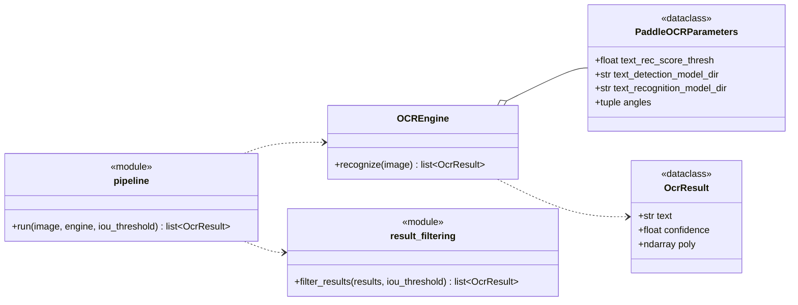
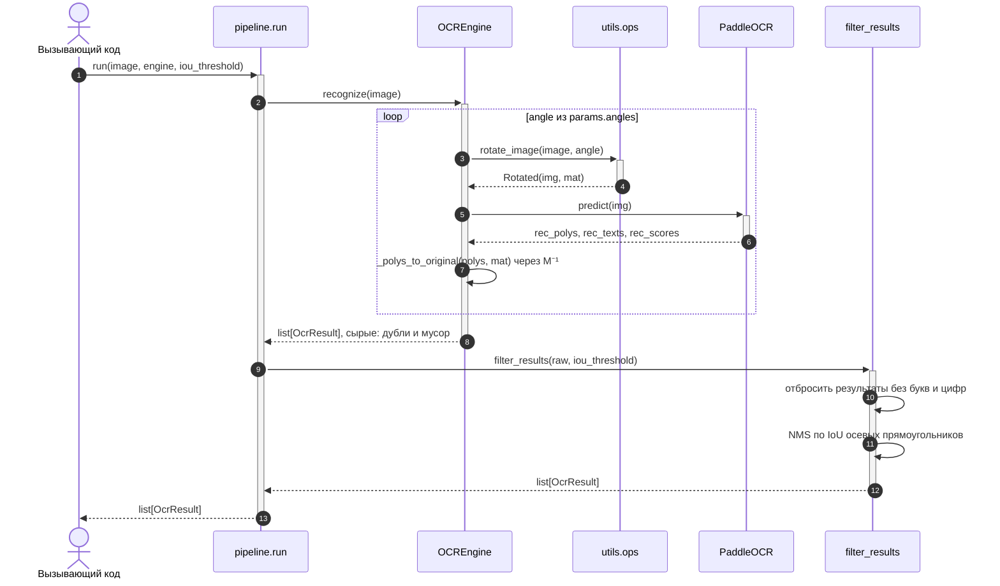

# core.ocr

Распознаёт текст на растровом чертеже (размерные надписи, позиции, технические требования) через PaddleOCR и
возвращает строки с полигонами в координатах исходного листа.

## Использование

```python
from draftslice.core.ocr.engine import OCREngine, PaddleOCRParameters
from draftslice.core.ocr.pipeline import run

engine = OCREngine(PaddleOCRParameters())  # модели грузятся один раз на пачку листов
results = run(img, engine)                 # list[OcrResult]
for r in results:
    r.text, r.confidence, r.poly           # строка, уверенность, полигон (4, 2) float32, точки (x, y)
```

## Интерфейс



| Объект | Файл | Описание |
|---|---|---|
| `run(image, engine, iou_threshold)` | `pipeline.py` | Распознавание и фильтрация: единственная точка входа |
| `OCREngine.recognize(image)` | `engine.py` | Прогон детекции и распознавания на каждом угле поворота; сырой список |
| `filter_results(results, iou_threshold)` | `result_filtering.py` | Убирает нетекстовый мусор и дубли между поворотами |
| `OcrResult` | `engine.py` | Строка, уверенность и полигон в координатах исходного листа |

## Аргументы

`PaddleOCRParameters`:

| Аргумент | Тип | По умолчанию | Описание |
|---|---|---|---|
| `text_rec_score_thresh` | `float` | `0.3` | Порог уверенности распознавания |
| `text_detection_model_dir` | `str` | `../models/PP-OCRv6_medium_det_infer` | Папка модели детекции |
| `text_recognition_model_dir` | `str` | `../models/cyrillic_PP-OCRv5_mobile_rec_infer` | Папка модели распознавания |
| `text_detection_model_name` | `str` | `PP-OCRv6_medium_det` | Имя модели детекции |
| `text_recognition_model_name` | `str` | `cyrillic_PP-OCRv5_mobile_rec` | Имя модели распознавания |
| `angles` | `tuple[float, ...]` | `(0, 90, 270)` | Углы поворота листа, градусы, на которых ищется текст |

`run`:

| Аргумент | Тип | По умолчанию | Описание |
|---|---|---|---|
| `image` | `np.ndarray` | — | Лист RGB `(H, W, 3)` |
| `engine` | `OCREngine` | — | Заранее созданный движок |
| `iou_threshold` | `float` | `0.3` | Порог IoU, выше которого результаты разных поворотов — одна надпись |

## Пайплайн



`OCREngine` держит загруженные модели, поэтому создаётся вызывающим кодом один раз и передаётся в `run`, а не
создаётся внутри на каждый лист.

## Шаг 1. Распознавание на нескольких поворотах

Детектор PaddleOCR надёжно находит только текст, близкий к горизонтальному, а размерные надписи на чертеже часто идут
вертикально вдоль размерных линий. `OCREngine.recognize` прогоняет полный цикл детекция + распознавание на каждом
угле из `angles`: лист поворачивается целиком (`utils.ops.rotate_image`, холст расширяется под новый размер), а
найденные `rec_polys` переводятся обратной матрицей поворота (`cv2.invertAffineTransform`) в систему координат
исходного листа. Другие модули всегда получают `OcrResult.poly` в одной системе координат, независимо от того, на
каком повороте найден текст.

$$
\text{poly}_{\text{original}} = M^{-1} \cdot \text{poly}_{\text{rotated}}
$$

$M$ — аффинная матрица поворота для угла и размера холста.

```text
угол 0°: найдено только горизонтальное        угол 90°: вертикальная надпись стала горизонтальной

┌──────────────────────────┐                  ┌───────────┐
│  [ 40 ]                  │                  │  [ 25 ]   │   polys → M⁻¹ → в координаты
│                      2   │                  │           │   исходного листа
│                      5   │                  └───────────┘
└──────────────────────────┘
```

!!! warning "Встроенный `use_textline_orientation` не решает задачу"
    Классификатор ориентации строки в PaddleOCR/PaddleX корректирует только 0° и 180° (`rotate_angle_list` принимает
    `0` или `1`). Для вертикального текста (90°/270°) он бесполезен.

## Шаг 2. Фильтрация и слияние дублей

Один и тот же текст может быть найден на нескольких поворотах. `filter_results`:

1. Отбрасывает результаты без единой буквы или цифры (`str.isalnum()`, корректно для кириллицы) — шум детектора на
   графике чертежа.
2. Убирает дубли между поворотами через NMS по IoU осевых прямоугольников полигонов: результаты сортируются по
   `confidence`, запись остаётся, если она не перекрывается больше `iou_threshold` с уже оставленной, более
   уверенной.

$$
\text{IoU}(a, b) = \frac{\text{area}(a \cap b)}{\text{area}(a \cup b)}
$$

!!! note "IoU по осевому прямоугольнику"
    Перекрытие считается по осевому прямоугольнику полигона, а не по самому четырёхугольнику: различить «та же
    надпись» и «соседняя надпись» этого достаточно. У полигона, повёрнутого далеко от осей, прямоугольник
    заметно больше самого полигона; на чертежах текст идёт под 0°, 90°, 180° и 270°, где они совпадают.

## Граница с другими модулями

`OcrResult` содержит только `text`, `confidence` и `poly` и ничего не знает о линиях чертежа. Потребители полигонов
(`denoise.text.clear_text`, правила `Sheet`) берут `OcrResult.poly` как вход.
