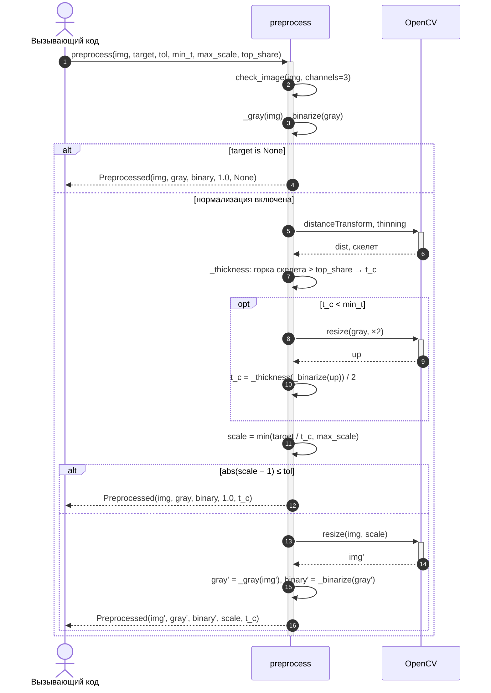

# core.preprocess

Серое, маска краски и масштаб, при котором контур детали имеет одну толщину на любом листе. О содержимом чертежа
(текст, размеры) модуль ничего не знает: толщину можно мерить по любой бинарной маске.

## Использование

```python
from draftslice.core.io import load_image
from draftslice.core.preprocess import preprocess

img = load_image("sheet.png")
prep = preprocess(img)             # контур приводится к 6 px
prep.scale, prep.t_c               # во сколько раз увеличен лист; толщина контура на исходнике, px
prep.binary                        # маска краски 0/255 в масштабе prep.img

prep = preprocess(img, target=None)  # без масштабирования: серое и маска исходного листа
```

Результат анализа в рабочем масштабе возвращается на исходный лист делением координат на `prep.scale`.

## Интерфейс

| Объект | Описание |
|---|---|
| `preprocess(img, ...)` | Серое, маска краски и масштаб, при котором контур равен `target` |
| `Preprocessed` | Результат: изображение, серое, маска, масштаб и толщина контура |

`Preprocessed` — `frozen dataclass`.

| Поле | Тип | Описание |
|---|---|---|
| `img` | `np.ndarray[uint8]` | RGB `(H, W, 3)` после масштабирования; тот же массив, если масштаб не менялся |
| `gray` | `np.ndarray[uint8]` | Серое `(H, W)` того же размера |
| `binary` | `np.ndarray[uint8]` | Маска краски `0/255` `(H, W)` того же размера |
| `scale` | `float` | Во сколько раз `img` больше исходного |
| `t_c` | `float \| None` | Толщина контура на исходном листе, px; `None`, если `target=None` |

## Аргументы

| Аргумент | Тип | По умолчанию | Описание |
|---|---|---|---|
| `target` | `float \| None` | `6.0` | Нужная толщина контура на выходе, px. `None` — не масштабировать |
| `tol` | `float` | `0.15` | Допуск масштаба: при `\|scale − 1\| ≤ tol` лист не трогают, `scale = 1` |
| `min_t` | `float` | `8.0` | Толщина контура, px, ниже которой замер повторяют на листе, увеличенном вдвое |
| `max_scale` | `float` | `4.0` | Верхняя граница увеличения: защита от почти невидимого контура |
| `top_share` | `float` | `0.06` | Доля пикселей скелета, с которой толщина считается горкой контура |

Ошибки: `TypeError` — не три канала; `ValueError` — параметры вне допустимых значений или в изображении нет краски
при включённой нормализации.

## Пайплайн



Публичная функция одна — `preprocess`; шаги приватные: `_gray`, `_binarize`, `_thickness`.

Серое — минимум по каналам, а не средневзвешенное: светлые цветные линии (жёлтая, оранжевая осевая) остаются
тёмными и попадают в маску.

## Оценка толщины контура

Толщина в точке скелета $t = 2 \cdot dist$, округлённая до px. На типичном листе у скелета три горки: тонкие линии
(2–3 px), выноски (4 px) и контур (6 px при ×2). Выше контура остаются только наконечники, и они редкие.
Толщина контура — самая толстая из толщин, на которую приходится не меньше `top_share` (6 %) пикселей скелета;
значение — среднее по этой горке.

Схема распределения толщины скелета (при ×2):

```text
доля скелета
 │ █
 │ █   ▄                        ┈┈ top_share
 │ █   █   ▄  ┈┈┈┈┈┈┈┈┈┈┈┈┈┈┈┈┈┈┈┈┈┈┈┈┈┈┈┈┈┈┈┈┈┈
 │ █   █   █         █                  ▁ ▁
 └─┴───┴───┴─────────┴──────────────────────▶ t, px
   2   3   4         6                  выше
 тонкие  выноски   контур            наконечники
                   ▲ самая толстая горка выше top_share → t_c
```

Запас по `top_share` на 17 листах: контурная горка занимает от 9.1 % (лист 17), самая частая толщина выше контура —
не больше 4.3 % (листы 11 и 12). Порог 6 % лежит между ними.

Замер на 17 листах совпал с эталоном (медиана толщины контура по графу линий `thick_lines`, пересчитанная на
исходный масштаб) в пределах шага квантования:

| Листы | Эталон, px | Оценка, px |
|---|---|---|
| 1–7, 9, 10, 15–17 | 3.0 | 3.0 |
| 11, 12 | 2.0 | 2.0 |
| 19 | 3.8 | 4.0 |
| 8 | 9.6 | 10.0 |
| 18 | 10.6 | 12.0 |

!!! warning "Нечётная ширина штриха"
    Расстояние до фона дискретно: у штриха нечётной ширины $w$ значение $2 \cdot dist$ равно $w + 1$, у чётной
    ширины — $w$. Поэтому на тонком контуре (3 px) замер по исходной маске даёт 4 px, и `preprocess`
    повторяет замер на увеличенном вдвое изображении, где контур 6 px чётный.

## Масштаб

$$scale = \min\left(\frac{target}{t_c},\ max\_scale\right), \qquad |scale - 1| \le tol \;\Rightarrow\; scale = 1$$

При `target = 6` на листах 1–7, 9, 10, 15–17 получается ×2.0, на 11 и 12 ×2.93, на 19 ×1.49, на 8 ×0.6, на 18 ×0.5
(исходная ширина листов — от 1085 до 5109 px).

Увеличение — `INTER_LINEAR_EXACT`, уменьшение — `INTER_AREA`.

!!! note "Масштаб нужен только для анализа"
    Очищенное изображение сохраняется в исходном масштабе. Поэтому `Preprocessed.scale` возвращается вызывающему,
    а маска из рабочего масштаба переносится на исходные пиксели функцией `utils.ops.scale_mask`.

!!! tip "Свои значения"
    `denoise.run` вызывает `preprocess` с `target=9.0` и `max_scale=2.0`, остальные аргументы — по умолчанию.
