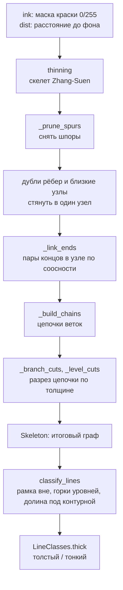

# Модуль: thick_lines

Из маски краски чертежа строит граф линий и делит линии на толстые (контур детали) и тонкие (размерные,
выносные, штриховка, рамки с номерами). Нужен, чтобы оставить контур и не повредить его.

## Пайплайн



| Шаг | Функция | Вход | Выход |
|---|---|---|---|
| 1. Граф линий | `build_graph` | маска краски, `dist` | `Skeleton` (итоговый граф) |
| 2. Классы толщины | `classify_lines` | граф, `dist`, `t_c` | `LineClasses` |

`build_graph` склеивает ветки по соосности и режет их по толщине внутри себя, поэтому дальше граф
используется как есть. `classify_lines` только читает граф и ничего в нём не меняет.

## Условности

- Координаты — `(row, col)`. Путь графа — последовательность пикселей скелета от одного конца к другому.
- **Толщина** $t = 2 \cdot dist$ — диаметр вписанного круга в точке скелета. Она квантована: $dist$ у
  cv2 на линиях вдоль сетки целый, поэтому на исходном масштабе $t$ идёт шагом 2 px (на листах 1, 10 и 19
  уровни линий 2 и 4). Лист увеличивают до бинаризации, см. [масштаб](../decisions/thick_lines.md).
- **Уровень линии** — среднее геометрическое её толщины без пятен стыков:

    $$level = \exp\left(\overline{\ln t}\right)$$

    Толщина мультипликативна (линия в два раза толще, а не на 2 px), поэтому все пороги работают с отношениями.
- Соседние куски одной линии делят крайний пиксель.
- Все длины и толщины — в пикселях рабочего изображения, после увеличения.

## Шаг 1. Скелет и снятие шпор

Скелет Zhang–Suen даёт в пятне стыка короткие тупики: у широкого пересечения, у конца толстой линии.
Ветка, у которой один конец свободный, другой в узле, а длина не больше толщины в узле, — шпора пятна, а не
линия. Её снимают, пока что-то снимается: после снятия узел может стать проходным.

```text
до                          после
  ────────┬────────           ───────────────────
          ╵
        шпора: свободный конец, длина ≤ толщины в узле
```

## Шаг 2. Дубли и близкие узлы

- **Ребро-дубль** — ветка из двух точек между узлами, параллельная другой ветке с теми же концами
  (ступенька скелета на диагонали). Убирается.
- **Близкие узлы** — стык, распавшийся на несколько узлов: ветка между двумя узлами короче суммы радиусов
  их пятен ($dist$ в узлах). Узлы и ветка стягиваются в один узел.

После каждой правки skan пересобирает ветки.

## Шаг 3. Склейка по соосности

В каждом узле концы веток объединяются в пары, каждый конец входит не больше чем в одну пару. Порядок:

1. дуги одной окружности (их центры и радиусы совпадают в пределах `tol` радиуса) — первыми;
2. соосные концы по возрастанию излома, но не больше `max_kink_deg`.

Толщина при склейке не учитывается. Короткий тупик (свободный конец, длина не больше толщины в узле)
направление не держит и в пары не входит: он не должен перехватывать пару у настоящей линии.

```text
  A ──────────┬────────── B     A и B: излом ≈ 0° ≤ max_kink_deg → одна линия A–B
              │
              C                 C: излом 90° → остаётся отдельной веткой
```

Склеенные ветки образуют цепочку, цепочка — один путь графа до следующего шага.

## Шаг 4. Разрез по толщине

Цепочка может быть линией со сменой толщины без узла: толстый контур переходит в тонкую выноску, клин
наконечника стоит на конце размерной линии. Профиль $t$ вдоль цепочки сначала очищается от **пятен
стыков**: вокруг каждого узла (степень ≥ 3) на $\lceil t/2 \rceil$ точек в обе стороны значения заменяются
интерполяцией по соседям вне пятен — там скелет меряет стык, а не линию.

**Разрез по узлам.** Ветка цепочки режется по своим узлам в отдельный кусок, если её уровень (по точкам вне
пятен) отличается от уровня остальной цепочки (тоже вне пятен) больше чем в `thick_ratio` раз. Ветка, целиком
покрытая пятнами, не режется: в ней скелет мерил только стыки. Отдельного порога длины нет — его задают пятна.

```text
линия   ──────────┼══════┼──────────          короткий толстый кусок между двумя пересечениями:
t       3 3 3 3 3 ▒ 7 7 7 ▒ 3 3 3 3 3          ветка между узлами 7 против 3 у остальной цепочки
                  └ кусок ┘                    → отдельный кусок
```

Бинарное разбиение ниже ищет один разрез за раз и такой кусок из середины длинной линии не вырезает: ни
один одиночный разрез не меняет среднюю толщину частей в `thick_ratio` раз.

Дальше каждый кусок режется бинарным разбиением по логарифму толщины — для смены толщины без узла. Для
разреза перед точкой $i$ в профиле из $n$ точек:

$$\Delta_i = \left|\overline{\ln t}_{[0,i)} - \overline{\ln t}_{[i,n)}\right|, \qquad
i^* = \arg\max_i \sqrt{\tfrac{i\,(n-i)}{n}}\;\Delta_i$$

Разрез в $i^*$ принимается, если $\Delta_{i^*} > \ln r$, где $r$ — **`thick_ratio`** (единственный порог по
толщине), а обе части не короче $3$ толщин линии. Каждая часть режется дальше тем же правилом. Ниже порога
линия остаётся одной, выше — режется.

```text
контур  ═════════════════════──────────────────
t       6 6 6 6 6 6 6 6 6 6 6  2 2 2 2 2 2 2 2 2
                              ▲
                  отношение 3 > thick_ratio → две линии: толстая и тонкая
```

**Клин наконечника.** Если клин не короче 3 толщин линии и его средняя толщина больше чем в
`thick_ratio` раз средней толщины остальной линии, он может стать отдельным куском. Границу куска задаёт
лучший разрез по формуле выше, а не начало клина:

```text
размерная   ─────────────────────────────────▶
t           2 2 2 2 2 2 2 2 2 2 2 2 2 2 2 4 6 8 7 4
                                            └ клин ┘ → отдельный кусок
```

**Короткий горб в пятнах стыков остаётся в линии.** Горб короче 3 толщин почти не меняет среднюю толщину
ни одной из двух частей любого разреза, и разрез не проходит порог. Типичный случай — линия, пересекающая
дугу: между двумя близкими узлами скелет меряет краску дуги, а не линии, и пятна узлов покрывают всю ветку
между ними, поэтому разрез по узлам её тоже не трогает.

```text
линия   ────────────●══●────────────────
t       2 2 2 2 2 2 7 7 2 2 2 2 2 2 2 2          горб в 2 точки между двумя узлами:
                    └┘                           весь в пятнах узлов: не разрезается, уровень линии 2
```

Для разбора, почему линия не разделилась, см. ячейку `show_line` в блокноте `exp_clear_drawing`: она
показывает профиль $t$, уровень линии, полосу $\pm$ `thick_ratio` и лучший возможный разрез с его отношением.

## Шаг 5. Классы толщины

Уровни линий графа образуют распределение с весом по длине линии. Линии одного класса дают горку, поэтому
порог ищется между горками, а не по Otsu и не по среднему: Otsu зависит от соотношения масс классов и от шума
(рукописный лист), среднее может лечь на саму горку (лист 7: среднее 4.02 при горке рамки 4.0).


1. **Рамка.** Линия, охватывающая не меньше доли `frame_span` (0.9) листа по высоте или ширине, — рамка. Она не часть чертежа
   и сама даёт горку (на листе 7 — единственная линия уровня 4.0). Из плотности, горок и масс она исключена;
   класс по порогу получает как обычная линия.
2. **Плотность** логарифма уровня оценивается гауссовым ядром шириной `bandwidth` (0.05: горки ближе
   $e^{4 \cdot 0.05} \approx 1.2$ раз сливаются), вес линии — её длина.
3. **Значимые горки** — максимумы плотности с выступом не меньше `prominence` (0.05) от максимума плотности.
   Остальные максимумы — `weak`, на график выводятся, в классы не входят.
4. **Контурная горка** — значимая, ближайшая к толщине контура листа $t_c \cdot scale$ (замер `preprocess`).
   Горок выше неё (наконечники) это не касается: они выше порога и толстые.
5. **Порог** — минимум плотности между контурной горкой и ближайшей значимой горкой под ней. Линия толстая,
   если её уровень выше порога.
6. **Масса горки** — доля длины линий (без рамки) между соседними долинами.
7. Под контурной горкой значимых горок нет — порога нет (`thr = None`), все линии толстые. Так сделано по
   OQ-04 канона: потеря геометрии хуже оставшегося шума.
8. **Разрывы толстой линии (`bridge`).** Короткий путь — короче трёх толщин соседних толстых, как минимальная
   часть разреза по толщине в шаге 4, — своей надёжной толщины не имеет: между узлами штриховки скелет меряет
   стык, и кусок контура получает уровень тонкой. Он толстый, если с обоих концов к нему примыкают толстые пути
   и хотя бы с одного он продолжает толстый почти по прямой (излом не больше `max_kink_deg`, как в склейке
   шага 3) — так проходит и излом контура. Штрих штриховки подходит к линиям под углом и остаётся тонким.

```text
контур  ══════════┼──┼══════════         кусок между узлами (14 px) намерен тонким:
                  └┬─┘                   с обоих концов толстые, продолжение по прямой → толстый (bridge)
        ══════════════════════
             ╲                           штрих между толстыми под 45° → тонкий
        ══════════════════════
```

На листе 11 (тонкий профиль со штриховкой) без этого правила профиль рвался на куски: кусок с двумя изгибами
`denoise` снимал как обозначение, остальные становились отдельными видами.

```text
доля длины
 │ █
 │ █                          ▄
 │ █▃                         █▃
 └─┴─┴───────────┬────────────┴───────▶ уровень, px
   2.0         порог 4.75    6.0
   тонкие      (рамка 4.0     контур: контурная горка
               не в счёте)
```

Пример — лист 7 (×2): горки 2.0 (тонкие, штриховка, размерные) и 6.0 (контур), порог 4.75.

`LineClasses` возвращает метки `thick`, уровни и длины линий (`level`, `length`, float32) и всё, по чему найден
порог: `frame`, `thr`, `peaks`, `weak`, `valleys`, `masses`, `contour`, `grid`, `dens`; `bridge` — пути, толстые по соседям. График разделения горок
рисует блокнот по этим полям, в библиотеке рисования нет: matplotlib в dev-зависимостях.
