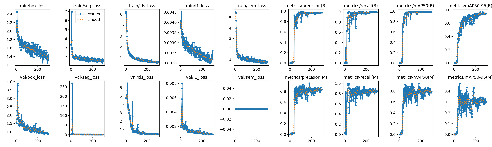
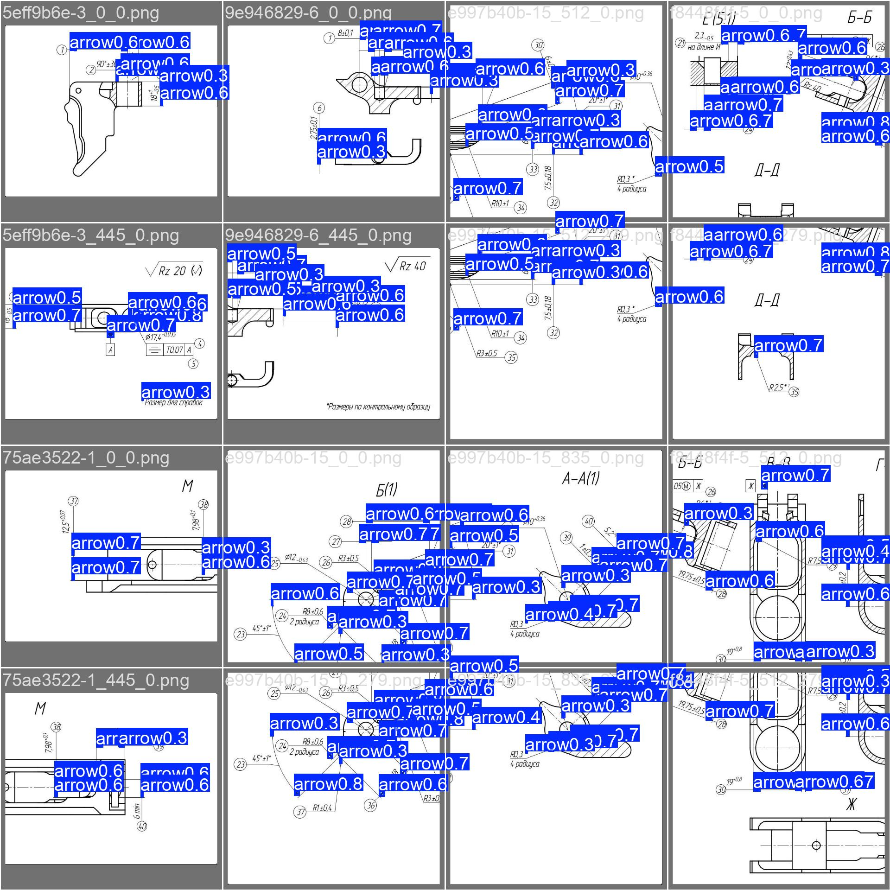

# Обучение модели стрелок

YOLO26n-seg для `draftslice.core.denoise.ArrowModel`: сегментация стрелок на плитках чертежа. Цепочка:
**Label Studio → `make_dataset.py` → `train.py` → `export.py` → `models/arrows.onnx`**, проверка — `infer.py`.

Скрипты не зависят от пакета `draftslice`: обучение — `ultralytics` и OpenCV, экспорт — `onnx` и `onnxslim` (группа
`training`), инференс — `onnxruntime-gpu` (основные зависимости).

## Установка

```bash
uv sync --group training
```

## Где что лежит

| Что | Где | В git |
|---|---|---|
| Код прогона | `training/` | да |
| Экспорт Label Studio (исходник, руками не правим) | `data/dataset/` | нет |
| Датасеты YOLO | `data/dataset_yolo/<режим>/` | нет |
| Предобученные веса Ultralytics | `weights/` (`weights_dir` в `yolo settings`) | нет |
| Запуски обучения | `runs/segment/<имя>/` (`runs_dir` в `yolo settings`) | нет |
| Выбранная модель для инференса | `models/arrows.onnx` | да, как модели OCR |
| Картинки инференса по листам | `data/output/arrows/` | нет |

## 1. Разметка в Label Studio

1. Стрелки размечаются в Label Studio полигонами, один класс `arrow`.
2. Экспорт — формат **YOLOv8 with Images** (YOLO-seg вместе с картинками).
3. Распакованный экспорт переносится **с заменой** в `data/dataset/`: `images/`, `labels/`, `classes.txt`. Служебные
   файлы macOS (`._*`) скрипты пропускают.

## 2. Датасет

Листы делятся на train и val целиком, не по стрелкам: стрелки одного листа похожи друг на друга, и при разбиении по
объектам val видел бы обучающие листы.

```bash
python training/make_dataset.py --overwrite
```

Результат — `data/dataset_yolo/tiles`: плитки 640 в исходном масштабе листа, сетка SAHI, перекрытие 0.2.
Папку можно скопировать на другую машину: в `data.yaml` нет ключа `path`.

## 3. Обучение

```bash
python training/train.py --data data/dataset_yolo/tiles/data.yaml --imgsz 640 --epochs 300
```

Запуск пишется в `runs/segment/<имя>/` (`weights/best.pt`, `results.csv`, кривые). Повторный запуск с тем же именем
Ultralytics пишет в `<имя>2`, `<имя>3`; своё имя — `--name`.

Аугментации — поля `Augment` в `train.py`, рассчитаны на чёрно-белые чертежи (цвет выключен, повороты на любой угол,
масштаб, отражения, небольшое размытие). Переопределяются флагами: `--degrees 90`, `--scale 0.7`, `--blur 0`.

## 4. Экспорт в ONNX

Выбранный запуск попадает в `models/arrows.onnx`:

```bash
python training/export.py --weights runs/segment/<имя>/weights/best.pt
```

ONNX экспортируется со встроенным NMS (`nms=True`): та же голова и тот же NMS, что у `predict`/`val` на `.pt`,
результат совпадает с Ultralytics (`retina_masks=True`). Порог встроенного NMS зашивается в граф и ограничивает
`--conf` инференса снизу, поэтому экспорт идёт с `conf=0.001`, как у `val`. `export.py` не даёт Ultralytics
доустанавливать пакеты: при нехватке пакета экспорт падает с сообщением.

## 5. Проверка по листам

Рисунки со стрелками красным поверх листа — в `data/output/arrows/`, в консоль — число стрелок и время на лист:

```bash
python training/infer.py data/images --out data/output/arrows
```

| Флаг | По умолчанию | Описание |
|---|---|---|
| `--conf` | `0.25` | Порог уверенности |
| `--model` | `models/arrows.onnx` | Другой ONNX |
| `--cpu` | выкл. | Без GPU |

## Метрики

Запуск `runs/segment/tiles_yolo26n-seg_640-8`: `yolo26n-seg.pt`, плитки 640, 300 эпох, `degrees` 180, `scale` 0.5.
Лучшие веса (`best.pt`) — эпоха 119, валидация — 18 плиток:

| Вывод | Precision | Recall | mAP50 | mAP50-95 |
|---|---|---|---|---|
| Бокс | 0.969 | 0.985 | 0.985 | 0.682 |
| Маска | 0.920 | 0.936 | 0.917 | 0.434 |



Метрика маски (`mAP50-95(M)`) на валидации колеблется от эпохи к эпохе в пределах примерно 0.2–0.47: проверочная
выборка мала. Для выбора модели смотрите и на картинки инференса по листам (шаг 5), а не только на метрики.

Предсказания на валидационных плитках:



## Обучение на целых листах

Скрипты поддерживают и режим целых листов:

```bash
python training/make_dataset.py --no-tile --overwrite    # data/dataset_yolo/full
python training/train.py --data data/dataset_yolo/full/data.yaml --imgsz 1280
```

> [!WARNING]
> Рабочая модель обучена на **плитках**, и `ArrowModel` режет лист той же сеткой (плитка 640, перекрытие 0.2): без
> нарезки выигрыш от неё пропадает. `ArrowModel` рассчитан на модель, обученную на плитках. Метрики
> Ultralytics на плитках и на целых листах несравнимы: для сравнения режимов нужен прогон на целых val-листах в
> координатах листа.

## Параметры

| Параметр | Скрипт | По умолчанию | Описание |
|---|---|---|---|
| `--src` | `make_dataset.py` | `data/dataset` | Экспорт Label Studio |
| `--tile` | `make_dataset.py` | `640` | Сторона плитки, px |
| `--overlap` | `make_dataset.py` | `0.2` | Перекрытие плиток, доля стороны |
| `--min-area` | `make_dataset.py` | `0.5` | Доля площади объекта, которая должна остаться в плитке |
| `--bg-ratio` | `make_dataset.py` | `0.25` | Плиток без стрелок в train, доля от числа плиток со стрелками; в val остаются все |
| `--val-share` | `make_dataset.py` | `0.2` | Доля объектов в val |
| `--val` | `make_dataset.py` | — | Листы для val вручную, номером или именем: `--val 1 5` |
| `--seed` | `make_dataset.py`, `train.py` | `0` | Разбиение train/val; обучение |
| `--no-tile` | `make_dataset.py` | выкл. | Не резать, листы копируются целиком |
| `--overwrite` | `make_dataset.py` | выкл. | Перезаписать готовый датасет |
| `--model` | `train.py` | `yolo26n-seg.pt` | Предобученные веса, ищутся в `weights_dir` |
| `--imgsz` | `train.py`, `export.py` | `640` | Сторона входа сети: равна плитке |
| `--epochs`, `--patience` | `train.py` | `100`, `50` | Число эпох и терпение ранней остановки |
| `--batch` | `train.py` | `-1` | Размер батча; `-1` — автоподбор Ultralytics |
| `--mask-ratio` | `train.py` | `4` | Понижение разрешения масок при обучении |

С теми же `--val-share`, `--seed`, `--val` режимы с плитками и без них дают одно и то же разбиение, поэтому модели
сравнимы на одних val-листах.
